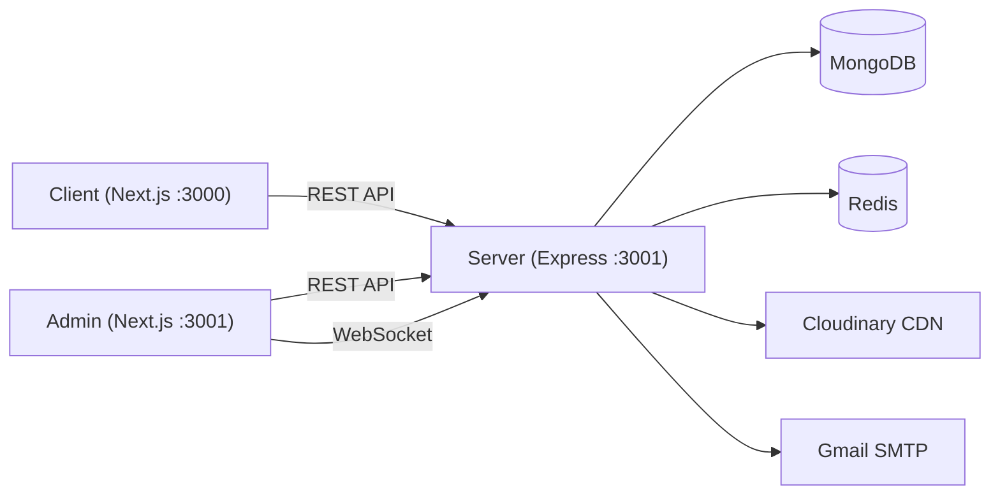
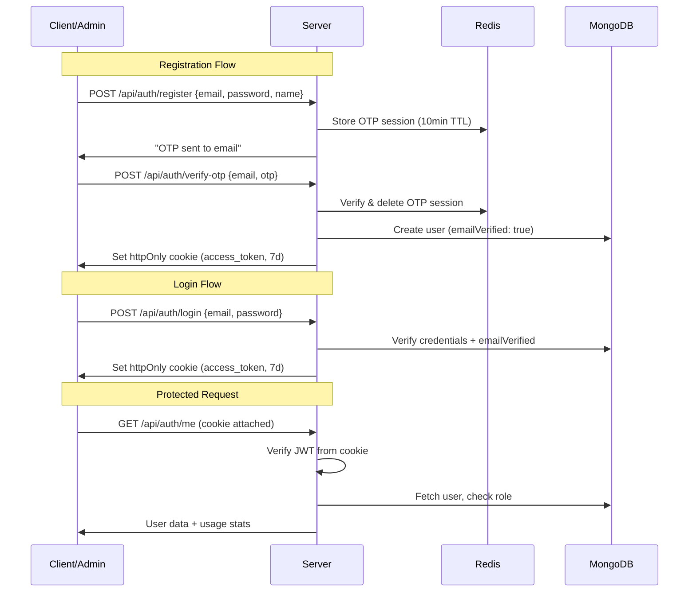
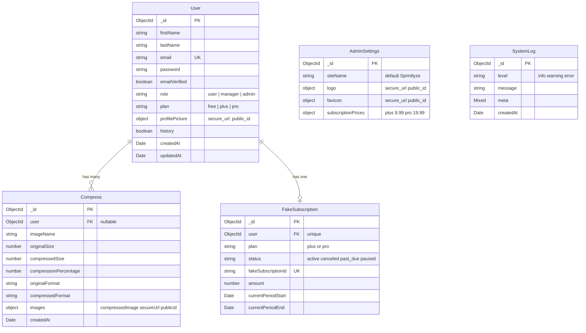

# PressIt 🗜️

**PressIt** is a full-stack image compression platform that lets users upload images, compress them to a target size using server-side processing, and manage their compression history. It features tiered subscription plans with daily compression limits, a complete authentication system, and a dedicated admin dashboard for platform management.

## Architecture Overview



| Application | Role | Tech |
|---|---|---|
| **Server** | REST API, auth, compression, subscriptions, admin endpoints | Express.js 5, TypeScript |
| **Client** | Public-facing UI — compress images, manage profile, subscribe | Next.js 16, React 19 |
| **Admin** | Internal dashboard — users, managers, stats, settings, logs | Next.js 16, React 19 |

---

## Key Features

### Compression Engine
- Server-side image compression via **Sharp** with binary-search quality optimization
- Supports JPEG, PNG, WebP, and SVG uploads (max 20 MB)
- User-specified compression percentage (1–99%)
- Guest users receive Base64 output; authenticated users get Cloudinary-hosted URLs
- Compression history with pagination for authenticated users

### Authentication & Authorization
- Email/password registration with **OTP email verification** (6-digit, SHA-256 hashed, stored in Redis with 10-min TTL)
- **Google OAuth** login via `google-auth-library`
- JWT tokens stored in **httpOnly cookies** (7-day expiry, `sameSite: strict`)
- Forgot password flow with OTP verification
- Two-step email change (verify current email → verify new email)
- Role-based access control: `user`, `manager`, `admin`

### Subscription System
- Simulated subscription system with `plus` and `pro` tiers
- Checkout, cancel, and webhook endpoints with HMAC-SHA256 signature verification
- Subscription prices configurable via admin settings
- 30-day billing periods

### Admin Dashboard
- Dashboard overview with stats: total users, managers, earnings, subscriptions
- User management (list, view, delete)
- Manager management (create, list, delete) — admin only
- Site settings: site name, logo, favicon, subscription pricing
- Real-time system logs via **Socket.IO**
- Subscription table with pagination

### Tiered Rate Limiting

| Tier | Daily Compressions |
|---|---|
| Guest | 5 |
| Free | 10 |
| Plus | 200 |
| Pro | 1,000 |
| Manager | 500 |
| Admin | 10,000 |

Enforced via Redis counters with 24-hour TTL, keyed by `compress:{tier}:{userId|ip}:{date}`.

---

## User Roles & Permissions

| Capability | Guest | User (free/plus/pro) | Manager | Admin |
|---|---|---|---|---|
| Compress images | ✅ (Base64 only) | ✅ (Cloudinary) | ✅ | ✅ |
| View compression history | ❌ | ✅ | ✅ | ✅ |
| Update profile / password | ❌ | ✅ | ✅ (profile only) | ✅ |
| Change email | ❌ | ✅ | ❌ | ✅ |
| Delete own account | ❌ | ✅ | ❌ | ❌ |
| Toggle history saving | ❌ | ✅ | ❌ | ❌ |
| Purchase subscription | ❌ | ✅ | ❌ | ❌ |
| Access admin dashboard | ❌ | ❌ | ✅ (read) | ✅ (full) |
| Manage users (view/delete) | ❌ | ❌ | ✅ (view) | ✅ |
| Manage managers | ❌ | ❌ | ✅ (view) | ✅ (CRUD) |
| Update site settings | ❌ | ❌ | ❌ | ✅ |
| View/delete system logs | ❌ | ❌ | ✅ (view) | ✅ (view + delete) |

- **Guest**: Unauthenticated. Can compress with Base64 output. No history saved.
- **User**: Authenticated via Client app. Plans: `free`, `plus`, `pro`.
- **Manager**: Created by Admin. Accesses Admin dashboard with read-only restrictions.
- **Admin**: Full platform control. Accesses Admin dashboard with all permissions.

---

## Technology Stack

### Server

| Category | Technology |
|---|---|
| Runtime | Node.js |
| Framework | Express.js 5 |
| Language | TypeScript 6 |
| Database | MongoDB (Mongoose 9) |
| Caching / Rate Limiting | Redis (ioredis, Upstash) |
| Auth | JWT (jsonwebtoken), Google OAuth (google-auth-library), bcryptjs |
| Image Processing | Sharp |
| Cloud Storage | Cloudinary |
| File Uploads | Multer (memory storage) |
| Email | Nodemailer (Gmail SMTP) |
| Real-time | Socket.IO |
| Security | Helmet, CORS, custom CSRF, express-rate-limit |
| Validation | express-validator |
| Task Scheduling | node-cron |
| Dev Tools | tsx (watch mode) |

### Client

| Category | Technology |
|---|---|
| Framework | Next.js 16 |
| Library | React 19 |
| Styling | Tailwind CSS 4 |
| Data Fetching | TanStack React Query 5 |
| UI | Base UI, Shadcn, class-variance-authority |
| Icons | FontAwesome 7, Lucide React |
| Auth | @react-oauth/google |
| Client Compression | browser-image-compression |
| Payments (placeholder) | @paddle/paddle-js |
| Notifications | react-hot-toast |

### Admin

| Category | Technology |
|---|---|
| Framework | Next.js 16 |
| Library | React 19 |
| Styling | Tailwind CSS 4 |
| Data Fetching | TanStack React Query 5 |
| Charts | Recharts |
| Real-time | socket.io-client |
| Icons | FontAwesome 7, Lucide React |
| Dates | date-fns |
| Notifications | react-hot-toast |

---

## Project Structure

```
pressit/
├── server/                          # Express.js backend API
│   ├── config/
│   │   ├── cloudinary.ts            # Cloudinary SDK configuration
│   │   ├── db.ts                    # MongoDB connection
│   │   ├── limits.ts                # Daily compression limits per tier
│   │   └── redis.ts                 # Redis (ioredis) connection
│   ├── middlewares/
│   │   ├── auth.middleware.ts       # Protect, authorizeRoles, optionalProtect
│   │   ├── checkCompressionLimit.middelware.ts
│   │   ├── csrf.middleware.ts       # Origin-based CSRF protection
│   │   ├── upload.middleware.ts     # Multer config (20MB, image types)
│   │   └── validate.middleware.ts   # express-validator result handler
│   ├── modules/
│   │   ├── admin/                   # Admin stats, settings, users, managers, logs
│   │   ├── auth/                    # Login, register, OTP, Google OAuth
│   │   ├── compress/                # Image compression, history, CRUD
│   │   ├── fake-subscription/       # Simulated subscription lifecycle
│   │   └── user/                    # Profile, password, email, history toggle
│   ├── utils/                       # Shared utilities (email, OTP, Cloudinary, errors)
│   ├── jops/                        # Cron jobs (guest image cleanup)
│   ├── types/                       # TypeScript interfaces
│   └── index.ts                     # App entry point
├── client/                          # Public-facing Next.js frontend
│   ├── app/
│   │   ├── (auth)/                  # Login, signup, password reset pages
│   │   ├── history/                 # Compression history page
│   │   ├── pricing/                 # Subscription plans page
│   │   ├── profile/                 # User profile & settings page
│   │   └── page.tsx                 # Home — DropZone compressor
│   ├── features/                    # API client functions by domain
│   ├── components/                  # UI components
│   ├── hooks/                       # Custom React hooks
│   ├── lib/                         # HTTP client (client-side & server-side)
│   └── providers/                   # Google OAuth, QueryClient, Paddle
├── admin/                           # Admin dashboard Next.js frontend
│   ├── app/
│   │   ├── login/                   # Admin/Manager login page
│   │   └── (dashboard)/             # Protected dashboard layout
│   │       ├── page.tsx             # Stats overview + subscription table
│   │       ├── users/               # User list + detail pages
│   │       ├── managers/            # Manager list + detail pages
│   │       ├── settings/            # Site settings page
│   │       ├── logs/                # Real-time system logs page
│   │       └── profile/             # Admin profile page
│   ├── features/                    # API client functions
│   ├── components/                  # Shared + UI components
│   └── lib/                         # HTTP client (client-side & server-side)
└── README.md
```

---

## Getting Started

### Prerequisites

- **Node.js** v20+
- **MongoDB** (local or Atlas)
- **Redis** (local or [Upstash](https://upstash.com))
- **Cloudinary** account
- **Gmail** account (for SMTP email, with App Password)
- **Google Cloud** project (for OAuth Client ID)

### 1. Server Setup

```bash
cd server
npm install
```

Create `server/.env`:

```env
PORT=3001
MONGODB_URL=your_mongodb_connection_string
JWT_SECRET=your_jwt_secret
NODE_ENV=development
ALLOWED_ORIGINS=http://localhost:3000,http://localhost:3001

EMAIL_USER=your_email@gmail.com
EMAIL_PASS=your_gmail_app_password

GOOGLE_CLIENT_ID=your_google_client_id

CLOUDINARY_CLOUD_NAME=your_cloud_name
CLOUDINARY_API_KEY=your_api_key
CLOUDINARY_API_SECRET=your_api_secret

REDIS_URL=your_redis_url

CLIENT_URL=http://localhost:3000

FAKE_WEBHOOK_SECRET=your_webhook_secret
```

Start the server:

```bash
npm run dev
```

Server runs on `http://localhost:3001`.

### 2. Client Setup

```bash
cd client
npm install
```

Create `client/.env`:

```env
NEXT_PUBLIC_API_URL=http://localhost:3001/api
NEXT_PUBLIC_GOOGLE_CLIENT_ID=your_google_client_id
```

```bash
npm run dev
```

Client runs on `http://localhost:3000`.

### 3. Admin Setup

```bash
cd admin
npm install
```

Create `admin/.env`:

```env
NEXT_PUBLIC_API_URL=http://localhost:3001/api
NEXT_PUBLIC_GOOGLE_CLIENT_ID=your_google_client_id
```

```bash
npm run dev
```

Admin runs on `http://localhost:3001` (or the next available port).

> **Note**: An admin user must be created directly in the database (set `role: "admin"`) since there is no self-registration flow for admin accounts.

---

## Environment Variables

### Server (`server/.env`)

| Variable | Required | Description |
|---|---|---|
| `PORT` | Yes | Server port (default: `3001`) |
| `MONGODB_URL` | Yes | MongoDB connection string |
| `JWT_SECRET` | Yes | Secret for signing JWT tokens |
| `NODE_ENV` | No | `development` or `production` |
| `ALLOWED_ORIGINS` | No | Comma-separated allowed CORS/CSRF origins |
| `EMAIL_USER` | Yes | Gmail address for sending OTP emails |
| `EMAIL_PASS` | Yes | Gmail app password |
| `GOOGLE_CLIENT_ID` | Yes | Google OAuth 2.0 Client ID |
| `CLOUDINARY_CLOUD_NAME` | Yes | Cloudinary cloud name |
| `CLOUDINARY_API_KEY` | Yes | Cloudinary API key |
| `CLOUDINARY_API_SECRET` | Yes | Cloudinary API secret |
| `REDIS_URL` | Yes | Redis connection URL |
| `CLIENT_URL` | No | Client app URL |
| `FAKE_WEBHOOK_SECRET` | No | HMAC secret for subscription webhooks |

### Client & Admin (`client/.env`, `admin/.env`)

| Variable | Required | Description |
|---|---|---|
| `NEXT_PUBLIC_API_URL` | Yes | Server API base URL (e.g., `http://localhost:3001/api`) |
| `NEXT_PUBLIC_GOOGLE_CLIENT_ID` | Yes | Google OAuth 2.0 Client ID |

---

## Authentication & Authorization



**Key implementation details:**

- **Tokens**: JWT signed with `JWT_SECRET`, containing `{ userId }`, expires in 7 days
- **Cookie**: `access_token`, httpOnly, secure in production, sameSite strict
- **OTP**: 6-digit numeric, SHA-256 hashed, stored in Redis with `otp:` prefix and 600s TTL
- **Google OAuth**: Verifies ID token server-side via `google-auth-library`, auto-creates user if new
- **Role check**: `authorizeRoles(...roles)` middleware compares `req.user.role` against allowed roles
- **CSRF**: Origin header validated against `ALLOWED_ORIGINS` on all HTTP methods
- **Rate limiting**: Auth routes limited to 10 requests per 15 minutes via `express-rate-limit`

---

## API Reference

All endpoints are prefixed with `/api`. Authentication is via `access_token` httpOnly cookie.

### Auth (`/api/auth`)

| Method | Route | Auth | Description |
|---|---|---|---|
| `POST` | `/google` | No | Google OAuth login/register |
| `POST` | `/login` | No | Email/password login (rate-limited) |
| `POST` | `/register` | No | Register + send OTP email (rate-limited) |
| `POST` | `/verify-otp` | No | Verify registration OTP → create user |
| `POST` | `/password/forgot` | No | Send forgot-password OTP |
| `POST` | `/password/forgot/otp` | No | Verify forgot-password OTP |
| `PATCH` | `/password/reset` | No | Reset password (after OTP verified) |
| `POST` | `/logout` | Yes | Clear auth cookie |
| `GET` | `/me` | Yes | Get current user + daily usage stats |

### User (`/api/users`) — All require auth

| Method | Route | Roles | Description |
|---|---|---|---|
| `PATCH` | `/update-profile` | admin, user, manager | Update first/last name |
| `PATCH` | `/change-password` | admin, user | Change password |
| `PATCH` | `/change-email` | admin, user | Initiate email change (sends OTP) |
| `POST` | `/change-email/verify-current-otp` | admin, user | Verify current email OTP |
| `POST` | `/change-email/verify-new-otp` | admin, user | Verify new email OTP → update |
| `PATCH` | `/upload-profile-picture` | Any auth | Upload profile picture to Cloudinary |
| `PATCH` | `/toggle-history` | user | Toggle compression history saving |
| `DELETE` | `/delete-user` | user | Delete own account |

### Compression (`/api/compress`)

| Method | Route | Auth | Description |
|---|---|---|---|
| `POST` | `/compress` | Optional | Compress image. `percent` (1–99), `compress-image` file. Guests get Base64; auth users get Cloudinary URL. |
| `GET` | `/history` | Yes (user, admin, manager) | Paginated compression history (`?page=&limit=`) |
| `GET` | `/:id` | Yes (user, admin, manager) | Get single compressed image by ID |
| `DELETE` | `/:id` | Yes (user, admin, manager) | Delete compressed image (+ Cloudinary) |

### Subscriptions (`/api/fake-subscription`)

| Method | Route | Auth | Description |
|---|---|---|---|
| `POST` | `/webhook` | No (signature) | Webhook for subscription events (HMAC verified) |
| `POST` | `/checkout` | Yes | Create subscription (`price_plus` or `price_pro`) |
| `POST` | `/cancel` | Yes | Cancel active subscription |
| `GET` | `/status` | Yes | Get current subscription status |

### Admin (`/api/admin`)

| Method | Route | Auth | Roles | Description |
|---|---|---|---|---|
| `GET` | `/settings` | No | — | Get site settings (public) |
| `POST` | `/managers` | Yes | admin | Create a manager account |
| `GET` | `/managers` | Yes | admin, manager | List all managers |
| `DELETE` | `/managers/:id` | Yes | admin | Delete a manager |
| `GET` | `/stats` | Yes | admin, manager | Dashboard statistics + subscriptions |
| `PATCH` | `/settings` | Yes | admin | Update site settings (multipart: logo, favicon) |
| `GET` | `/system/logs` | Yes | admin, manager | Get paginated system logs |
| `DELETE` | `/system/logs` | Yes | admin | Delete all system logs |
| `GET` | `/users` | Yes | admin, manager | List all users (role: user) |
| `GET` | `/users/:id` | Yes | admin, manager | Get user by ID |
| `DELETE` | `/users/:id` | Yes | admin | Delete a user |

---

## Database

**MongoDB** with **Mongoose 9** ODM. Four collections:



**Indexes:**
- `User.email` — unique index
- `Compress` — compound index on `{ user: 1, createdAt: -1 }`
- `FakeSubscription.user` — unique
- `FakeSubscription.fakeSubscriptionId` — unique

**Cron job:** Runs hourly, deletes guest compression records (where `user: null`) older than 2 hours and their associated Cloudinary assets.

---

## Error Handling & Validation

### Server-side
- **Custom `AppError` class**: Extends `Error` with `statusCode`, `status` (`fail` for 4xx, `error` for 5xx), and optional `errors` array
- **`asyncHandler` wrapper**: Catches async errors and forwards to Express error handler
- **Global error handler**: Returns consistent JSON (`{ status, statusCode, message, errors }`) and logs errors to `SystemLog` collection + broadcasts via Socket.IO
- **Validation**: `express-validator` rules on auth and user routes, processed by `validate` middleware that aggregates error messages

### Response format
```json
// Success
{ "success": true, "data": { ... } }

// Error
{ "status": "fail", "statusCode": 400, "message": "...", "errors": [] }
```

### Upload restrictions
- Max file size: **20 MB**
- Allowed MIME types: `image/jpeg`, `image/jpg`, `image/png`, `image/webp`, `image/svg`, `image/svg+xml`

---

## Development Commands

### Server

```bash
cd server
npm run dev       # Start with tsx watch (hot reload)
npm run build     # Compile TypeScript to dist/
npm run start     # Run compiled JS from dist/
```

### Client

```bash
cd client
npm run dev       # Next.js dev server
npm run build     # Production build
npm run start     # Start production server
npm run lint      # Run ESLint
```

### Admin

```bash
cd admin
npm run dev       # Next.js dev server
npm run build     # Production build
npm run start     # Start production server
npm run lint      # Run ESLint
```

---

## Security

| Mechanism | Implementation |
|---|---|
| **Password hashing** | bcryptjs with salt factor 10 (pre-save hook) |
| **JWT** | httpOnly, secure (production), sameSite strict cookies |
| **CORS** | Whitelist-based origin validation |
| **CSRF** | Origin header check against `ALLOWED_ORIGINS` |
| **Rate limiting** | Auth routes: 10 req/15 min. Compression: Redis-based daily limits per tier |
| **Helmet** | Standard HTTP security headers |
| **OTP security** | SHA-256 hashed, Redis-stored with 10-min TTL, IP-scoped for registration |
| **File validation** | MIME type whitelist, 20 MB size limit via Multer |
| **Webhook auth** | HMAC-SHA256 signature verification with timing-safe comparison |
| **Password exclusion** | `-password` select on all user queries returned to clients |
| **Google OAuth** | Server-side ID token verification via `google-auth-library` |

---

## Troubleshooting

| Issue | Solution |
|---|---|
| `REDIS_URL is not defined` | Ensure `REDIS_URL` is set in `server/.env`. Use an Upstash URL or local Redis (`redis://localhost:6379`). |
| `Missing MONGODB_URL` | Set `MONGODB_URL` in `server/.env`. For local: `mongodb://localhost:27017/pressit`. |
| `CORS: origin not allowed` | Add your frontend URL to `ALLOWED_ORIGINS` in `server/.env` (comma-separated). |
| Admin login redirects to `/login` | Only users with `role: "admin"` or `role: "manager"` can access the dashboard. Create an admin user directly in MongoDB. |
| OTP emails not sending | Ensure `EMAIL_USER` and `EMAIL_PASS` are set. Use a Gmail App Password (not your account password). |
| Port conflicts | Server defaults to `:3001`, Client to `:3000`. Admin will auto-increment if `:3001` is taken. |
| `JWT secret not found` | Set `JWT_SECRET` in `server/.env` with a strong random string. |
| Images not loading in Next.js | `res.cloudinary.com` is configured in `next.config.ts` `remotePatterns`. Ensure Cloudinary credentials are correct. |

---

## License

ISC (as specified in `server/package.json`). Client and Admin packages are private.
